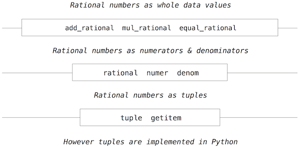

## 2.2   数据抽象

当我们考虑世界中那些想在程序中表示的众多事物时，会发现它们大多具有复合结构。一个日期有年、月、日；一个地理位置有纬度和经度坐标。为了表示位置，我们希望编程语言有能力把纬度和经度耦合在一起构成一个对（pair），即一个*复合数据*（compound data）值，我们的程序可以把它当作单一的概念单元来操作，同时它又有两个可以分别考虑的部分。

使用复合数据使我们能够提高程序的模块化程度。如果我们能把地理位置当作独立的、自成一体的对象来直接操作，那么我们就能把程序中处理值的那部分与这些值可能如何表示的细节分离开来。把程序中处理「数据如何表示」的部分与处理「数据如何操作」的部分隔离开来的通用技术，是一种强大的设计方法论，称为*数据抽象*（data abstraction）。数据抽象使程序在设计、维护和修改上都容易得多。

数据抽象在性质上类似于函数抽象。当我们创建一个函数抽象时，函数如何实现的细节可以被隐藏起来，而该函数本身可以被任何具有相同整体行为的其他函数替换。换句话说，我们可以做出一种抽象，把函数的使用方式与函数如何实现的细节分离开来。类似地，数据抽象是一种方法论，它使我们能够把复合数据对象如何使用与它如何构造的细节隔离开来。

数据抽象的基本思想是：把程序设计成操作抽象数据。也就是说，我们的程序使用数据时应当对数据做出尽可能少的假设。与此同时，定义一个具体的数据表示，独立于使用该数据的程序。我们系统这两部分之间的接口将是一组函数，称为选择器（selector）和构造器（constructor），它们用具体的表示来实现抽象数据。为了说明这一技术，我们将考虑如何设计一组用于操作有理数的函数。

阅读接下来几节时请记住，如今所写的大多数 Python 代码都使用语言内建的非常高级的抽象数据类型，例如类、字典和列表。由于我们正在建立对这些抽象如何运作的理解，我们自己暂时还不使用它们。因此，我们会写一些并不典型于大多数 Python 程序员实现这些想法时所用风格的代码。不过，我们所写的内容是有教益的，因为它展示了这些抽象是如何构造出来的。请记住，计算机科学不仅仅在于学会使用编程语言，还在于理解它们如何运作。

### 2.2.1   示例：有理数的算术

回想一下，有理数是两个整数之比，而有理数构成了实数的一个重要子类。像 `1/3` 或 `17/29` 这样的有理数通常写作：

```python
<numerator>/<denominator>
```

其中 `<numerator>` 和 `<denominator>` 都是整数值的占位符。两个部分都是精确刻画该有理数值所必需的。

有理数在计算机科学中很重要，因为它们像整数一样可以被精确表示。无理数（如 `pi`、`e` 或 `sqrt(2)`）则用有限的二进制展开来近似。因此，原则上处理有理数应当能让我们避免算术中的近似误差。

然而，一旦我们真正用分子除以分母，就会得到一个被截断的十进制近似值（一个 `float`）。

```python
>>> 1/3
0.3333333333333333
```

而当我们开始做测试时，这种近似的问题就出现了：

```python
>>> 1/3 == 0.333333333333333300000  # Beware of approximations
True
```

计算机如何用有限长度的十进制展开来近似实数，是另一门课的话题。这里重要的思想是：通过把有理数表示为整数之比，我们完全避免了近似问题。因此，为了精确起见，我们希望把分子和分母分开保存，但把它们当作一个整体来处理。

从使用函数抽象的经验中我们知道，在程序的某些部分尚未实现之前，我们也可以卓有成效地开始编程。让我们先假设已经有办法从分子和分母构造出一个有理数。我们还假设，给定一个有理数，我们有办法提取（或选择）它的分子和分母。我们再进一步假设，构造器和选择器是下面这三个可用的函数：

- `rational(n, d)` 返回分子为 `n`、分母为 `d` 的有理数。
- `numer(x)` 返回有理数 `x` 的分子。
- `denom(x)` 返回有理数 `x` 的分母。

我们在此使用一种强大的综合策略：*愿望思维*（wishful thinking）。我们还没有说明有理数如何表示，也没有说明函数 `numer`、`denom` 和 `rational` 应当如何实现。即便如此，如果我们确实拥有这三个函数，就可以通过调用它们来对有理数做加法、乘法和相等性测试：

```python
>>> def add_rationals(x, y):
        nx, dx = numer(x), denom(x)
        ny, dy = numer(y), denom(y)
        return rational(nx * dy + ny * dx, dx * dy)
```

```python
>>> def mul_rationals(x, y):
        return rational(numer(x) * numer(y), denom(x) * denom(y))
```

```python
>>> def equal_rationals(x, y):
        return numer(x) * denom(y) == numer(y) * denom(x)
```

现在我们有了用选择器函数 `numer` 和 `denom`、以及构造器函数 `rational` 来定义的有理数操作，但这些函数本身尚未定义。我们需要的是某种把分子和分母粘合为一个单元的办法。

### 2.2.2   对

为了使我们能够实现数据抽象的具体层次，Python 提供了一种名为 `tuple` 的复合结构，它可以通过用逗号分隔值来构造。虽然并非严格要求，但圆括号几乎总是包围着 tuple。

```python
>>> (1, 2)
(1, 2)
```

tuple 的元素可以通过两种方式解包。第一种是我们熟悉的多重赋值方法。

```python
>>> pair = (1, 2)
>>> pair
(1, 2)
>>> x, y = pair
>>> x
1
>>> y
2
```

事实上，多重赋值一直在创建和解包 tuple。

访问 tuple 中元素的第二种方法是通过索引运算符，用方括号表示。

```python
>>> pair[0]
1
>>> pair[1]
2
```

Python 中的 tuple（以及大多数其他编程语言中的序列）是 0 索引的，意味着索引 0 选择第一个元素，索引 1 选择第二个，依此类推。这一索引约定背后的一种直觉是：索引表示元素相对于 tuple 开头的偏移量。

元素选择运算符的等价函数称为 `getitem`，它也使用 0 索引位置来从 tuple 中选择元素。

```python
>>> from operator import getitem
>>> getitem(pair, 0)
1
```

tuple 是原生类型，这意味着有内建的 Python 运算符来操作它们。我们稍后会回到 tuple 的完整性质。目前，我们只关心 tuple 如何充当实现抽象数据类型的粘合剂。

**表示有理数。** tuple 提供了一种自然的方式，把有理数实现为两个整数的对：一个分子和一个分母。我们可以通过操作二元 tuple 来实现有理数的构造器和选择器函数。

```python
>>> def rational(n, d):
        return (n, d)
```

```python
>>> def numer(x):
        return getitem(x, 0)
```

```python
>>> def denom(x):
        return getitem(x, 1)
```

一个用于打印有理数的函数完成了我们对该抽象数据类型的实现。

```python
>>> def rational_to_string(x):
        """Return a string 'n/d' for numerator n and denominator d."""
        return '{0}/{1}'.format(numer(x), denom(x))
```

连同我们之前定义的算术操作，我们就可以用已定义的这些函数来操作有理数。

```python
>>> half = rational(1, 2)
>>> rational_to_string(half)
'1/2'
>>> third = rational(1, 3)
>>> rational_to_string(mul_rationals(half, third))
'1/6'
>>> rational_to_string(add_rationals(third, third))
'6/9'
```

如上面的例子所示，我们的有理数实现不会把有理数约简到最简形式。我们可以通过修改 `rational` 来补救。如果我们有一个计算两个整数最大公约数的函数，就可以用它把分子和分母在构造对之前约简到最简形式。与许多有用的工具一样，这样的函数已经存在于 Python 库中。

```python
>>> from fractions import gcd
>>> def rational(n, d):
        g = gcd(n, d)
        return (n//g, d//g)
```

双斜杠运算符 `//` 表示整数除法，它把除法结果的小数部分向下取整。由于我们知道 `g` 能整除 `n` 和 `d`，此处的整数除法是精确的。现在我们有

```python
>>> rational_to_string(add_rationals(third, third))
'2/3'
```

正如所期望的那样。这一修改是通过改变构造器完成的，而没有改动任何实现实际算术操作的函数。

**延伸阅读。** 上面的 `rational_to_string` 实现使用了*格式字符串*（format string），其中包含值的占位符。如何使用格式字符串以及 `format` 方法的细节，见 Dive Into Python 3 的[格式化字符串](http://getpython3.com/diveintopython3/strings.html#formatting-strings)一节。

### 2.2.3   抽象屏障

在继续介绍更多复合数据与数据抽象的例子之前，让我们思考有理数例子所引出的一些问题。我们以构造器 `rational` 和选择器 `numer`、`denom` 来定义操作。一般来说，数据抽象的底层思想是：为每一种值确定一组基本操作，对该类型值的一切操作都通过这些操作来表达，然后在操作数据时只使用这些操作。

我们可以把有理数系统的结构设想为一系列层次。



水平线代表抽象屏障（abstraction barrier），它们把系统的不同层次隔离开来。在每个层次上，屏障把使用该数据抽象的函数（上方）与实现该数据抽象的函数（下方）分隔开。使用有理数的程序仅通过它们的算术函数来操作它们：`add_rationals`、`mul_rationals` 和 `equal_rationals`。而这些算术函数又仅通过构造器和选择器 `rational`、`numer` 和 `denom` 来实现，后者自身则通过 tuple 来实现。只要 tuple 能支持选择器和构造器的实现，tuple 如何实现的细节对其余各层而言就是无关紧要的。

在每个层次上，方框内的函数强制执行了抽象边界，因为它们是对上方表示（通过使用）和下方实现（通过定义）同时产生依赖的唯一一批函数。这样一来，抽象屏障就表现为一组组函数。

抽象屏障带来许多好处。一个好处是，它们使程序更容易维护和修改。依赖某一特定表示的函数越少，当人们想要改变该表示时所需的改动就越少。

### 2.2.4   数据的性质

我们在开始实现有理数时，是用三个未加说明的函数来定义算术操作的：`rational`、`numer` 和 `denom`。在那一刻，我们可以把这些操作视为定义在数据对象 —— 分子、分母和有理数 —— 之上，而这些对象的行为是由后三个函数指定的。

但数据究竟意味着什么？仅仅说「凡是由给定选择器和构造器所实现的东西」是不够的。我们需要保证这些函数合起来指定了正确的行为。也就是说，如果我们从整数 `n` 和 `d` 构造出有理数 `x`，那么应当有 `numer(x)/denom(x)` 等于 `n/d`。

一般来说，我们可以把抽象数据类型视为由某一组选择器和构造器、连同一些行为条件所定义。只要行为条件得到满足（比如上面的除法性质），这些函数就构成了该数据类型的一个有效表示。

这一观点同样可以应用于其他数据类型，比如我们用来实现有理数的二元 tuple。我们其实从未对 tuple 是什么说过太多，只是说语言提供了创建和操作 tuple 的运算符。现在我们可以描述二元 tuple（也称为对，pair）中与表示有理数这个问题相关的行为条件了。

为了实现有理数，我们需要一种把两个整数粘合起来的途径，它具有如下行为：

- 如果对 `p` 由值 `x` 和 `y` 构造而来，那么 `getitem_pair(p, 0)` 返回 `x`，`getitem_pair(p, 1)` 返回 `y`。

我们可以实现满足这一描述的函数 `pair` 和 `getitem_pair`，效果与 tuple 一样好。

```python
>>> def pair(x, y):
        """Return a function that behaves like a two-element tuple."""
        def dispatch(m):
            if m == 0:
                return x
            elif m == 1:
                return y
        return dispatch
```

```python
>>> def getitem_pair(p, i):
        """Return the element at index i of pair p."""
        return p(i)
```

用这个实现，我们就可以创建和操作对。

```python
>>> p = pair(20, 13)
>>> getitem_pair(p, 0)
20
>>> getitem_pair(p, 1)
13
```

这种对函数的使用方式与我们关于数据应当是什么的直觉概念毫不相似。尽管如此，这些函数已足以在程序中表示复合数据。

值得注意的微妙之处在于，`pair` 返回的值是一个名为 `dispatch` 的函数，它接受参数 `m` 并返回 `x` 或 `y`。然后，`getitem_pair` 调用这个函数来取出相应的值。本章中我们将多次回到分派函数（dispatch function）这一话题。

展示对的函数式表示，其要点并非 Python 实际上就是这样工作的（出于效率原因，tuple 的实现更为直接），而是它*可以*这样工作。函数式表示虽然晦涩，却是一种完全恰当的对的表示方式，因为它满足了对所需要满足的唯一条件。这个例子还表明，把函数作为值来操作的能力，自动赋予了我们表示复合数据的能力。
