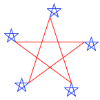
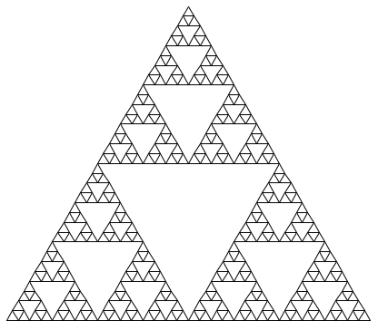

## 3.2   函数式编程（functional programming）

运行在任何现代计算机上的软件都是用各种各样的编程语言写成的。有些是物理层面的语言，例如特定计算机的机器语言。这些语言关注的是如何用单个存储位和基本机器指令来表示数据与控制。使用机器语言的程序员关心的是如何利用给定的硬件来搭建系统和工具，以便高效地实现资源受限的计算。建立在机器语言基础之上的高级语言，则隐藏了对数据如何表示为位集合、程序如何表示为基本指令序列的关注。这些语言拥有组合手段和抽象手段，例如函数定义，它们适合软件系统在更大规模上的组织。

在本节中，我们介绍一门鼓励函数式风格的高级编程语言。我们的研究对象是 Scheme 语言的一个子集，它采用与 Python 非常相似的计算模型，但只使用表达式（没有语句），专精于符号计算，并且只使用不可变的值。

Scheme 是 [Lisp](http://en.wikipedia.org/wiki/Lisp_(programming_language)) 的一种方言，Lisp 是至今仍被广泛使用的第二古老编程语言（仅次于 [Fortran](http://en.wikipedia.org/wiki/Fortran)）。Lisp 程序员社区几十年来持续繁荣，而像 [Clojure](http://en.wikipedia.org/wiki/Clojure) 这样的 Lisp 新方言，其开发者社区的增长速度在现代编程语言中名列前茅。为了跟随本书中的示例进行练习，你可以[下载一个 Scheme 解释器](http://inst.eecs.berkeley.edu/~scheme/)。

### 3.2.1   表达式

Scheme 程序由表达式组成，表达式要么是调用表达式（call expression），要么是特殊形式（special form）。调用表达式由运算符表达式后跟零个或多个操作数子表达式构成，正如 Python 中那样。运算符和操作数都被包含在圆括号内：

```scheme
> (quotient 10 2)
5
```

Scheme 只使用前缀表示法。运算符通常是符号，例如 `+` 和 `*`。调用表达式可以嵌套，也可以跨越多行：

```scheme
> (+ (* 3 5) (- 10 6))
19
> (+ (* 3
        (+ (* 2 4)
           (+ 3 5)))
     (+ (- 10 7)
        6))
57
```

与 Python 一样，Scheme 表达式可以是基本表达式，也可以是组合式。数字字面量是基本表达式，而调用表达式是包含任意子表达式的组合形式。调用表达式的求值过程与 Python 一致：先对运算符和操作数表达式求值，然后把作为运算符值的函数应用于作为操作数值的参数。

Scheme 中的 `if` 表达式是一种*特殊形式*，这意味着虽然它在句法上看起来像调用表达式，但它的求值过程不同。`if` 表达式的一般形式是：

```scheme
(if <predicate> <consequent> <alternative>)
```

要对一个 `if` 表达式求值，解释器首先对表达式中的 `<predicate>` 部分求值。如果 `<predicate>` 求出一个真值，解释器接着对 `<consequent>` 求值并返回其值。否则，它对 `<alternative>` 求值并返回其值。

数值可以用我们熟悉的比较运算符来比较，但这里同样使用前缀表示法：

```scheme
> (>= 2 1)
#t
```

Scheme 中的布尔值 `#t`（或 `true`）和 `#f`（或 `false`）可以与布尔特殊形式组合使用，这些特殊形式的求值过程与 Python 中的类似。

> `(and <e1> ... <en>)` 解释器按从左到右的顺序一次对表达式 `<e>` 求值。如果任何一个 `<e>` 求出 `false`，`and` 表达式的值就是 `false`，其余 `<e>` 不再求值。如果所有 `<e>` 都求真值，`and` 表达式的值就是最后一个 `<e>` 的值。
> `(or <e1> ... <en>)` 解释器按从左到右的顺序一次对表达式 `<e>` 求值。如果任何一个 `<e>` 求出真值，该值就作为 `or` 表达式的值返回，其余 `<e>` 不再求值。如果所有 `<e>` 都求出 `false`，`or` 表达式的值就是 `false`。
> `(not <e>)` 当表达式 `<e>` 求出 `false` 时，not 表达式的值为 `true`，否则为 `false`。

### 3.2.2   定义

值可以使用 `define` 特殊形式来命名：

```scheme
> (define pi 3.14)
> (* pi 2)
6.28
```

新函数（在 Scheme 中称为*过程（procedure）*）可以用第二种 `define` 特殊形式来定义。例如，要定义平方，我们写作：

```scheme
(define (square x) (* x x))
```

过程定义的一般形式是：

```scheme
(define (<name> <formal parameters>) <body>)
```

`<name>` 是一个符号，它在环境中与这个过程定义相关联。`<formal parameters>` 是在过程体内用于引用过程相应参数的名字。`<body>` 是一个表达式，当形参被替换为过程所应用的实际参数后，它将给出该过程应用的值。`<name>` 和 `<formal parameters>` 被分组在圆括号内，正如它们在调用所定义过程时那样。

定义了 square 之后，我们现在就可以在调用表达式中使用它：

```scheme
> (square 21)
441

> (square (+ 2 5))
49

> (square (square 3))
81
```

用户定义的函数可以接受多个参数，并且可以包含特殊形式：

```scheme
> (define (average x y)
    (/ (+ x y) 2))
> (average 1 3)
2
> (define (abs x)
    (if (< x 0)
        (- x)
        x))
> (abs -3)
3
```

Scheme 支持局部定义，其词法作用域规则与 Python 相同。下面，我们使用嵌套定义和递归定义了一个用于计算平方根的迭代过程：

```scheme
> (define (sqrt x)
    (define (good-enough? guess)
      (< (abs (- (square guess) x)) 0.001))
    (define (improve guess)
      (average guess (/ x guess)))
    (define (sqrt-iter guess)
      (if (good-enough? guess)
          guess
          (sqrt-iter (improve guess))))
    (sqrt-iter 1.0))
> (sqrt 9)
3.00009155413138
```

匿名函数使用 `lambda` 特殊形式创建。`Lambda` 创建过程的方式与 `define` 相同，区别在于不为该过程指定名字：

```scheme
(lambda (<formal-parameters>) <body>)
```

所得到的过程与用 `define` 创建的过程一样，都是一个过程。唯一的区别在于，它没有与环境中任何名字相关联。事实上，下面两个表达式是等价的：

```scheme
> (define (plus4 x) (+ x 4))
> (define plus4 (lambda (x) (+ x 4)))
```

就像任何以过程为值的表达式一样，lambda 表达式可以用作调用表达式中的运算符：

```scheme
> ((lambda (x y z) (+ x y (square z))) 1 2 3)
12
```

### 3.2.3   复合值

序对（pair）是 Scheme 语言内置的。出于历史原因，序对使用内置函数 `cons` 创建，而序对的元素用 `car` 和 `cdr` 访问：

```scheme
> (define x (cons 1 2))
> x
(1 . 2)
> (car x)
1
> (cdr x)
2
```

递归列表也是语言内置的，它用序对来构建。一个记为 `nil` 或 `'()` 的特殊值表示空列表。递归列表值通过把其元素放在圆括号内、以空格分隔来呈现：

```scheme
> (cons 1
        (cons 2
              (cons 3
                    (cons 4 nil))))
(1 2 3 4)
> (list 1 2 3 4)
(1 2 3 4)
> (define one-through-four (list 1 2 3 4))
> (car one-through-four)
1
> (cdr one-through-four)
(2 3 4)
> (car (cdr one-through-four))
2
> (cons 10 one-through-four)
(10 1 2 3 4)
> (cons 5 one-through-four)
(5 1 2 3 4)
```

列表是否为空可以用基本谓词 `null?` 来判断。有了它，我们就可以定义用于计算 `length` 和选取元素的标准序列操作：

```scheme
> (define (length items)
    (if (null? items)
        0
        (+ 1 (length (cdr items)))))
> (define (getitem items n)
    (if (= n 0)
        (car items)
        (getitem (cdr items) (- n 1))))
> (define squares (list 1 4 9 16 25))
> (length squares)
5
> (getitem squares 3)
16
```

### 3.2.4   符号数据

到目前为止，我们使用过的所有复合数据对象最终都是由数字构建的。Scheme 的优势之一就是能够把任意符号当作数据来处理。

为了操作符号，我们需要在语言中引入一个新要素：*引用（quote）*数据对象的能力。假设我们想构造列表 `(a b)`。我们无法用 `(list a b)` 做到这一点，因为这个表达式构造的是 `a` 和 `b` 的值所构成的列表，而不是这些符号本身。在 Scheme 中，我们在符号 `a` 和 `b` 前加上一个单引号，从而引用这些符号本身而非它们的值：

```scheme
> (define a 1)
> (define b 2)
> (list a b)
(1 2)
> (list 'a 'b)
(a b)
> (list 'a b)
(a 2)
```

在 Scheme 中，任何不被求值的表达式都称为被*引用（quoted）*的。这种引用的概念源自一个经典的哲学区分：一个事物，例如一只四处跑动、汪汪叫的狗，与"dog"这个词——一个用于指称这类事物的语言构造——之间的区别。当我们在引号中使用"dog"时，我们指的不是某只特定的狗，而是一个词。在语言中，引用让我们能够谈论语言本身，在 Scheme 中也是如此：

```scheme
> (list 'define 'list)
(define list)
```

引用还让我们能够使用列表的常规打印表示来直接键入复合对象：

```scheme
> (car '(a b c))
a

> (cdr '(a b c))
(b c)
```

完整的 Scheme 语言还包含其他特性，例如可变操作、向量和映射。不过，我们目前所介绍的这个子集已经提供了一门丰富的函数式编程语言，足以实现本书中到目前为止讨论过的许多思想。

### 3.2.5   海龟绘图

作为本书配套的 Scheme 实现包含了海龟绘图（Turtle graphics），这是一个作为 Logo 语言（另一种 Lisp 方言）一部分而开发的图示环境。海龟从画布中心出发，根据过程移动和转向，并在移动时在其身后绘制线条。虽然海龟最初是为了让孩子们参与到编程活动中而发明的，但对于即便是高级程序员来说，它仍然是一个引人入胜的绘图工具。

在 Scheme 程序执行过程中的任何时刻，海龟在画布上都有一个位置和一个朝向。像 `forward` 和 `right` 这样的单参数过程会改变海龟的位置和朝向。常见过程都有缩写：`forward` 也可以写作 `fd`，等等。Scheme 中的 `begin` 特殊形式允许一个表达式包含多个子表达式。这个形式在发出多条命令时很有用：

```scheme
> (define (repeat k fn) (if (> k 0)
                            (begin (fn) (repeat (- k 1) fn))
                            nil))
> (repeat 5
          (lambda () (fd 100)
                     (repeat 5
                             (lambda () (fd 20) (rt 144)))
                     (rt 144)))
nil
```



海龟过程的完整集合也作为 [turtle 库模块](http://docs.python.org/py3k/library/turtle.html)内置于 Python 中。

作为最后一个例子，Scheme 可以用其海龟绘图以极为紧凑的形式表达递归图形。谢尔宾斯基三角形（Sierpinski's triangle）是一种分形，它把每个三角形绘制为三个相邻的三角形，这些相邻三角形的顶点位于包含它们的那个三角形两条腰的中点上。它可以借助下面这个 Scheme 程序绘制到有限递归深度：

```scheme
> (define (repeat k fn)
    (if (> k 0)
        (begin (fn) (repeat (- k 1) fn))
        nil))

> (define (tri fn)
    (repeat 3 (lambda () (fn) (lt 120))))

> (define (sier d k)
    (tri (lambda ()
           (if (= k 1) (fd d) (leg d k)))))

> (define (leg d k)
    (sier (/ d 2) (- k 1))
    (penup)
    (fd d)
    (pendown))
```

`triangle` 过程是一种通用方法，它把某个绘图过程重复三次，每次重复之后向左转。`sier` 过程接受一个长度 `d` 和一个递归深度 `k`。如果深度为 1，它就画一个普通三角形；否则它画一个由对 `leg` 的调用组成的三角形。`leg` 过程通过一次对 `sier` 的递归调用来绘制递归谢尔宾斯基三角形的一条腿，该调用填充这条腿长度的一半，然后把海龟移动到下一个顶点。过程 `penup` 和 `pendown` 通过抬笔和落笔，让海龟在移动时不绘制线条。`sier` 和 `leg` 之间的相互递归产生了这样的结果：

```scheme
> (sier 400 6)
```


