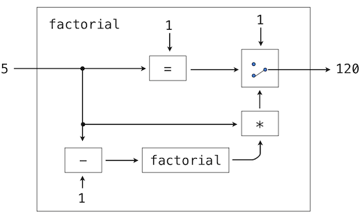

## 3.5   具有抽象能力的语言的解释器

Calculator 语言通过嵌套的调用表达式提供了一种组合手段。然而，它没有办法定义新的运算符、为值命名，或者表达通用的计算方法。Calculator 完全不支持抽象。因此，它并不是一门特别强大或通用的编程语言。现在我们转向这样一个任务：定义一门通用的编程语言，它通过把名字绑定到值以及定义新的操作来支持抽象。

上一节把完整的解释器以 Python 源码的形式呈现了出来，而本节则采用描述性的方式。配套项目要求你通过构建一个功能完备的 Scheme 解释器来实现这里提出的思想。

### 3.5.1   解释器的结构

本节描述 Scheme 解释器的总体结构。完成那个项目之后，你将得到一个此处所描述的解释器的可运行实现。

Scheme 解释器可以复用 Calculator 解释器的大量相同结构。解析器（parser）产生一个表达式，再由求值器（evaluator）对其进行求值（evaluation）。求值函数检查表达式的形式，对于调用表达式，它调用一个函数来把过程（procedure）应用于某些参数。求值器之间的差异大多与特殊形式、用户自定义函数，以及计算的环境模型的实现有关。

**解析（Parsing）。** Calculator 解释器中的 [scheme_reader](../examples/scalc/scheme_reader.py.html) 和 [scheme_tokens](../examples/scalc/scheme_tokens.py.html) 模块几乎足以解析任何合法的 Scheme 表达式。不过，它尚不支持引用（quotation）或点列表（dotted lists）。一个完整的 Scheme 解释器应当能够解析如下的输入表达式。

```python
>>> read_line("(car '(1 . 2))")
Pair('car', Pair(Pair('quote', Pair(Pair(1, 2), nil)), nil))
```

你在实现 Scheme 解释器时的第一个任务，就是扩展 [scheme_reader](../examples/scalc/scheme_reader.py.html)，使其能够正确地解析点列表和引用。

**求值（Evaluation）。** Scheme 一次对一个表达式求值。配套项目中 `scheme.py` 里定义了求值器的一个骨架实现。每个从 `scheme_read` 返回的表达式都被传给 `scheme_eval` 函数，后者在当前环境（environment）`env` 中对表达式 `expr` 求值。

`scheme_eval` 函数对 Scheme 中不同形式的表达式求值：基本元素、特殊形式和调用表达式。Scheme 中一个组合的形式可以通过检查它的第一个元素来确定。每个特殊形式都有自己的求值规则。下面给出 `scheme_eval` 的一个简化实现。为了聚焦于我们的讨论，一些错误检查和特殊形式的处理被去掉了。完整的实现出现在配套项目中。

```python
>>> def scheme_eval(expr, env):
        """Evaluate Scheme expression expr in environment env."""
        if scheme_symbolp(expr):
            return env[expr]
        elif scheme_atomp(expr):
            return expr
        first, rest = expr.first, expr.second
        if first == "lambda":
            return do_lambda_form(rest, env)
        elif first == "define":
            do_define_form(rest, env)
            return None
        else:
            procedure = scheme_eval(first, env)
            args = rest.map(lambda operand: scheme_eval(operand, env))
            return scheme_apply(procedure, args, env)
```

**过程应用（Procedure application）。** 上面的最后一种情况调用了第二个过程，即过程应用，它由函数 `scheme_apply` 实现。Scheme 中的过程应用过程比 Calculator 中的 `calc_apply` 函数要通用得多。它应用两类参数：`PrimitiveProcedure` 或 `LambdaProcedure`。`PrimitiveProcedure` 由 Python 实现；它有一个实例属性 `fn`，绑定到一个 Python 函数。此外，它可能需要、也可能不需要访问当前环境。每当该过程被应用时，都会调用这个 Python 函数。

`LambdaProcedure` 由 Scheme 实现。它有一个 `body` 属性，是一个 Scheme 表达式，每当该过程被应用时都会对它求值。要把该过程应用于一组参数，需要在一个新环境中对该 body 表达式求值。为了构造这个环境，需要向环境添加一个新的帧（frame），在该帧中，过程的形式参数被绑定到实参上。body 则使用 `scheme_eval` 求值。

**求值／调用递归（Eval/apply recursion）。** 实现求值过程的两个函数 `scheme_eval` 和 `scheme_apply` 是互相递归的。每当遇到调用表达式时，求值都需要调用。调用既使用求值把操作数表达式求值为参数，也使用求值来对用户自定义过程的 body 求值。这一互相递归过程的一般结构在解释器中相当普遍地出现：求值依据调用（apply）来定义，而调用又依据求值来定义。

这个递归循环终止于语言的基本元素。求值有一个基础情形，即对一个基本表达式求值。某些特殊形式同样构成不需要递归调用的基础情形。函数应用有一个基础情形，即应用一个基本过程。这种互相递归的结构——在处理表达式形式的 eval 函数与处理函数及其参数的 apply 函数之间——构成了求值过程的本质。

### 3.5.2   环境

既然我们已经描述了 Scheme 解释器的结构，下面转向实现构成环境的 `Frame` 类。每个 `Frame` 实例代表一个环境，其中符号被绑定到值。一个帧有一个 `bindings` 字典，还有一个 `parent` 帧，对于全局帧而言其 `parent` 为 `None`。

绑定不是被直接访问的，而是通过两个 `Frame` 方法访问：`lookup` 和 `define`。前者实现了第 1 章中所述计算的（environment）模型中的查找过程。一个符号会与当前帧的 `bindings` 进行匹配。如果找到了，就返回它所绑定的值。如果没有找到，查找将继续进行到 `parent` 帧。另一方面，`define` 方法则总是在当前帧中把一个符号绑定到一个值。

`lookup` 的实现以及 `define` 的使用留作练习。作为它们用法的示例，考虑下面这个 Scheme 程序：

```scheme
> (define (factorial n)
    (if (= n 0) 1 (* n (factorial (- n 1)))))
> (factorial 5)
120
```

第一个输入表达式是一个 `define` 特殊形式，由 Python 函数 `do_define_form` 求值。定义一个函数包含若干步骤：

1. 检查表达式的格式，确保它是一个格式良好的 Scheme 列表，且在关键字 `define` 之后至少有两个元素。
2. 分析第一个元素，在此例中是一个 `Pair`，从而找出函数名 `factorial` 和形式参数列表 `(n)`。
3. 用提供的形参、body 以及父环境创建一个 `LambdaProcedure`。
4. 在当前环境的第一个帧中把符号 `factorial` 绑定到这个函数。在此例中，该环境仅由全局帧构成。

第二个输入是一个调用表达式。传给 `scheme_apply` 的 `procedure` 就是刚才创建并绑定到符号 `factorial` 的那个 `LambdaProcedure`。传入的 `args` 是一个单元素的 Scheme 列表 `(5)`。要应用该过程，需要创建一个新帧来扩展全局帧（即 `factorial` 过程的父环境）。在这个帧中，符号 `n` 被绑定到值 5。然后，`factorial` 的 body 在该环境中被求值，并返回其值。

### 3.5.3   数据即程序

在思考一个求值 Scheme 表达式的程序时，某种类比可能有所帮助。关于程序含义的一种操作式观点是：程序是对一台抽象机器的描述。例如，再次考虑这个计算阶乘的过程：

```scheme
> (define (factorial n)
    (if (= n 0) 1 (* n (factorial (- n 1)))))
```

我们也可以用 Python 来表达一个等价的程序，使用条件表达式。

```python
>>> def factorial(n):
        return 1 if n == 1 else n * factorial(n - 1)
```

我们可以把这个程序看作是对一台机器的描述，这台机器包含执行递减、相乘和相等性测试的部件，还有一个双位开关和另一台阶乘机器。（这台阶乘机器是无限的，因为它内部又包含一台阶乘机器。）下图是阶乘机器的流程图，展示了各部件是如何连接在一起的。



以类似的方式，我们可以把 Scheme 解释器看作一台非常特殊的机器，它把对一台机器的描述作为输入。给定这个输入，解释器会配置自己去模拟所描述的机器。例如，如果把我们求值器与阶乘的定义一起喂给它，该求值器就能计算阶乘。

从这个角度看，我们的 Scheme 解释器被视为一台通用机器。当其他机器被描述为 Scheme 程序时，它就能模拟这些机器。它充当着我们的编程语言所操作的数据对象与编程语言自身之间的桥梁。设想一个用户向正在运行的 Scheme 解释器中键入一个 Scheme 表达式。从用户的角度看，诸如 `(+ 2 2)` 这样的输入表达式是编程语言中的一个表达式，解释器应当对它求值。然而，从 Scheme 解释器的角度看，这个表达式不过是一句按一套定义良好的规则去操作的话。

用户的程序就是解释器的数据，这不必成为混淆的根源。事实上，有时忽略这一区别是方便的，让用户能够显式地把一个数据对象作为表达式来求值。在 Scheme 中，每当使用 `run` 过程时我们就利用了这种能力。Python 中也有类似的函数：`eval` 函数会对一个 Python 表达式求值，而 `exec` 函数会执行一条 Python 语句。因此，

```python
>>> eval('2+2')
4
```

以及

```python
>>> 2+2
4
```

都返回同样的结果。对作为执行过程的一部分而构造出来的表达式进行求值，是动态编程语言中一个常见而强大的特性。很少有语言像 Scheme 那样频繁地使用这种做法，但能在程序执行过程中构造并求值表达式的能力，对任何程序员来说都可能被证明是一件有价值的工具。
