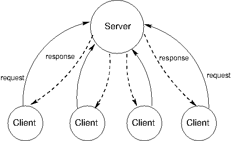

## 4.5   分布式计算

大规模数据处理应用常常需要协调多台计算机共同工作。分布式计算（distributed computing）应用是指由多台相互连接但又彼此独立的计算机协同完成一项联合计算的应用。

之所以说这些计算机是彼此独立的，是因为它们并不直接共享内存。相反，它们通过*消息*（messages）相互通信——消息是在网络上从一台计算机传送到另一台计算机的信息。

### 4.5.1   消息

计算机之间发送的消息是字节序列。消息的用途各不相同：消息可以请求数据、发送数据，或者指示另一台计算机去求值一个过程调用。无论哪种情况，发送方计算机都必须以接收方计算机能够解码并正确解释的方式来编码信息。为此，计算机会采用一种消息协议，为字节序列赋予意义。

*消息协议*（message protocol）是一组用于编码和解释消息的规则。发送方和接收方计算机必须对消息的语义达成一致，才能实现成功的通信。许多消息协议规定消息必须符合某种特定格式，其中固定位置上的某些比特表示固定的条件。另一些协议则使用特殊的字节或字节序列来分隔消息的各个部分，正如标点符号在编程语言的语法中分隔子表达式一样。

消息协议不是特定的程序或软件库。相反，它们是可被各种程序（甚至是用不同编程语言编写的程序）所应用的规则。因此，软件系统千差万别的计算机也能加入到同一个分布式系统中，只需遵守支配该系统的消息协议即可。

**TCP/IP 协议**。在互联网上，消息借助[网际协议](http://en.wikipedia.org/wiki/Internet_Protocol)（Internet Protocol，IP）从一台机器传送到另一台机器；IP 规定了如何在不同网络之间传输数据*包*（packet），以实现全球范围的互联网通信。IP 的设计基于这样一个假设：网络在任何一个环节本质上都不可靠，而且其结构是动态变化的。此外，它并不假设存在对通信的任何集中式跟踪或监控。每个包都包含一个头部，头部中含有目的 IP 地址以及其他信息。所有包都在网络中沿目标方向转发，转发过程依据简单的路由规则，采取尽力而为（best-effort）的方式。

这种设计对通信施加了约束。使用现代 IP 实现（IPv4 和 IPv6）传输的包最大为 65,535 字节。更大的数据值必须拆分到多个包中。IP 并不保证包会按照发送顺序被接收。有些包可能丢失，有些包可能被多次传输。

[传输控制协议](http://en.wikipedia.org/wiki/Transmission_Control_Protocol)（Transmission Control Protocol，TCP）是在 IP 之上定义的一种抽象，它提供对任意大小字节流的可靠、有序传输。该协议通过正确地对 IP 传输的包排序、去除重复包，并请求重传丢失的包来提供这一保证。这种更高的可靠性是以延迟（latency）为代价换来的，延迟即把一条消息从一点发送到另一点所需的时间。

TCP 把数据流切分成*TCP 段*（TCP segment），每一段都包含一部分数据，并在其前面带有一个头部，头部中含有支持可靠有序传输数据的序列号和状态信息。有些 TCP 段根本不包含数据，而是用于建立或终止两台计算机之间的连接。

在两台计算机 `A` 和 `B` 之间建立连接分三步进行：

1. `A` 向 `B` 的某个*端口*（port）发送请求以建立 TCP 连接，并提供一个*端口号*（port number），以便接收响应。
2. `B` 向 `A` 指定的端口发送响应，并等待其响应被确认。
3. `A` 发送一个确认响应，验证数据可以在两个方向上传输。

经过这个三步的"握手"之后，TCP 连接就建立起来了，`A` 和 `B` 可以互相发送数据。终止 TCP 连接则是一系列步骤：客户端和服务器都要请求并确认连接的结束。

### 4.5.2   客户端/服务器架构

客户端/服务器（client and server）架构是一种从中心源分发服务的方式。*服务器*（server）提供服务，多个*客户端*（client）与服务器通信以消费该服务。在这种架构中，客户端和服务器扮演不同的角色。服务器的角色是响应来自客户端的服务请求，而客户端的角色是发出请求并利用服务器的响应来完成某项任务。下图展示了这种架构。



该模型最富影响力的应用是现代万维网（World Wide Web）。当网页浏览器显示一个网页的内容时，多台独立计算机上运行的若干程序会以客户端/服务器架构进行交互。本节通过描述请求一个网页的过程，来说明客户端/服务器分布式系统中的核心思想。

**角色**。当请求一个网页时，网页用户计算机上的浏览器应用扮演客户端的角色。当从互联网上的某个域名（如 www.nytimes.com）请求内容时，它必须与至少两个不同的服务器通信。

客户端首先向域名服务器（Domain Name Server，DNS）请求位于该名称处计算机的网际协议（IP）地址。DNS 提供把域名映射到 IP 地址的服务，IP 地址是互联网上机器的数字标识符。Python 可以直接使用 `socket` 模块发出这样的请求。

```python
>>> from socket import gethostbyname
>>> gethostbyname('www.nytimes.com')
'170.149.172.130'
```

随后，客户端从位于该 IP 地址处的 Web 服务器请求网页的内容。此处的响应是一个 [HTML](http://en.wikipedia.org/wiki/HTML) 文档，其中包含当日新闻的标题和文章摘录，以及指示网页浏览器客户端应该如何把这些内容布局在用户屏幕上的表达式。Python 可以使用 `urllib.request` 模块发出检索这些内容所需的两个请求。

```python
>>> from urllib.request import urlopen
>>> response = urlopen('http://www.nytimes.com').read()
>>> response[:15]
b'<!DOCTYPE html>'
```

收到这一响应后，浏览器会针对图片、视频以及页面的其他辅助组成部分发出额外的请求。之所以发起这些请求，是因为最初的 HTML 文档中包含了附加内容的地址，以及对它们如何嵌入页面的描述。

**一次 HTTP 请求**。超文本传输协议（Hypertext Transfer Protocol，HTTP）是一种基于 TCP 实现的协议，它管理万维网（WWW）的通信。它假定网页浏览器与 Web 服务器之间是客户端/服务器架构。HTTP 规定了浏览器与服务器之间交换消息的格式。所有网页浏览器都用 HTTP 格式向 Web 服务器请求页面，所有 Web 服务器都用 HTTP 格式发回它们的响应。

HTTP 请求有若干类型，其中最常见的是针对特定网页的 `GET` 请求。一个 `GET` 请求会指定一个位置。例如，在网页浏览器中输入地址 `http://en.wikipedia.org/wiki/UC_Berkeley`，就会向 `en.wikipedia.org` 处 Web 服务器的 80 端口发出一个 HTTP `GET` 请求，以获取位置 `/wiki/UC_Berkeley` 处的内容。

服务器发回一个 HTTP 响应：

```python
HTTP/1.1 200 OK
Date: Mon, 23 May 2011 22:38:34 GMT
Server: Apache/1.3.3.7 (Unix) (Red-Hat/Linux)
Last-Modified: Wed, 08 Jan 2011 23:11:55 GMT
Content-Type: text/html; charset=UTF-8

... web page content ...
```

在第一行中，文本 `200 OK` 表明响应该请求时没有出现错误。头部的后续各行给出了关于服务器、日期以及所返回内容类型的信息。

如果你输入了错误的网址，或者点击了失效的链接，可能见过类似下面这样的错误消息：

```python
404 Error File Not Found
```

它的意思是服务器发回了一个以如下内容开头的 HTTP 头部：

```python
HTTP/1.1 404 Not Found
```

数字 200 和 404 是 HTTP 响应码。一组固定的响应码是消息协议的常见特征。协议设计者会设法预见将通过协议发送的常见消息，并为其分配固定的编码，以减小传输大小并建立共同的消息语义。在 HTTP 协议中，200 响应码表示成功，而 404 表示资源未找到这一错误。HTTP 1.1 标准中还存在各种其他的[响应码](http://en.wikipedia.org/wiki/List_of_HTTP_status_codes)。

**模块化**。*客户端*和*服务器*这两个概念是强大的抽象。服务器提供服务（可能同时服务于多个客户端），而客户端消费该服务。客户端不需要知道服务是如何提供的细节，也不需要知道它们接收到的数据是如何存储或计算出来的；服务器也不需要知道它的响应将被如何使用。

在 Web 上，我们把客户端和服务器视为位于不同的机器上，但即便是同一台机器上的系统也可以具有客户端/服务器架构。例如，计算机上输入设备发出的信号需要普遍可供该计算机上运行的程序使用。这些程序就是客户端，消费鼠标和键盘的输入数据。操作系统的设备驱动程序则是服务器，负责接收物理信号并将其作为可用的输入提供出来。此外，中央处理器（CPU）和专用的图形处理器（GPU）也常常参与一种客户端/服务器架构，其中 CPU 是客户端，而 GPU 是图像的服务器。

客户端/服务器系统的一个缺点是，服务器是单点故障（single point of failure）。它是唯一具有分发服务能力的组件。客户端可以有任意多个，它们可以互换，并且可以按需随意来去。

客户端/服务器系统的另一个缺点是，如果客户端过多，计算资源就会变得稀缺。客户端增加了对系统的需求，却没有贡献任何计算资源。

### 4.5.3   对等网络

客户端/服务器模型适用于面向服务的场景。然而，还有其他一些计算目标，对于它们而言更平均的分工才是更好的选择。*对等网络*（peer-to-peer）一词用于描述这样一类分布式系统：其中的劳动在系统的所有组成部分之间进行分配。所有计算机都发送和接收数据，它们都贡献一定的处理能力和内存。随着分布式系统规模的增长，其计算资源的容量也随之增长。在对等网络中，系统的所有组成部分都向一项分布式计算贡献一定的处理能力和内存。

所有参与者之间的分工是对等网络的显著特征。这意味着对等节点（peer）需要能够相互可靠地通信。为了确保消息到达其预期的目的地，对等网络需要有组织良好的网络结构。这些系统中的组成部分相互协作，维护关于其他组成部分位置的足够信息，以便把消息发送到预期的目的地。

在某些对等网络中，维护网络健康的工作由一组专门的组件承担。这类系统并非纯粹的对等网络，因为它们具有服务于不同功能的不同类型的组件。支撑对等网络的这些组件就像脚手架：它们帮助网络保持连通，维护关于不同计算机位置的信息，并帮助新加入者在其邻域中找到自己的位置。

对等网络最常见的应用是数据传输和数据存储。在数据传输中，系统中的每台计算机都为通过网络发送数据做出贡献。如果目标计算机位于某台特定计算机的邻域内，这台计算机就帮助沿路转发数据。在数据存储中，数据集可能太大而无法放进任何单台计算机，也可能太宝贵而无法只存放在一台计算机上。每台计算机存储数据的一小部分，并且同一份数据可能会有多个副本散布在不同的计算机上。当某台计算机发生故障时，它上面的数据可以从其他副本中恢复，并在替补机器到位后重新放回。

Skype 这一语音和视频聊天服务，就是具有对等架构的数据传输应用的一个例子。当两台不同计算机上的两个人进行 Skype 通话时，他们的通信通过对等网络传输。这个网络由其他运行 Skype 应用的计算机组成。每台计算机都知道其邻域中少数几台其他计算机的位置。一台计算机通过把包传给一个邻居、该邻居再传给某个别的邻居，如此继续，直到包到达其预期目的地，从而帮助把包发送到目的地。Skype 并不是一个纯粹的对等网络。一个由*超级节点*（supernode）构成的脚手架网络负责用户的登录和登出、维护关于其计算机位置的信息，并在用户进入和退出时修改网络结构。
